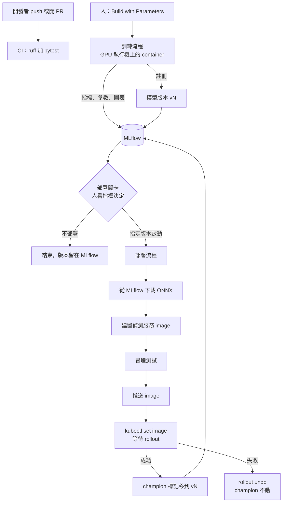

# YOLO MLOps 教學流程：GitHub + Jenkins + MLflow + K8s

這份範例示範一個 YOLO 偵測模型怎麼從「改程式」走到「在正式環境提供服務」，中間每一步由誰觸發、產出什麼。

範例用 Ultralytics 內建的 `coco8` 小資料集和 `yolo11n.pt`，幾分鐘就能跑完一次訓練，重點放在流程而不是模型本身。名詞定義見 [CONTEXT.md](CONTEXT.md)。

> 這是教材：GPU 執行機與正式環境的 K8s 都是假設存在的，位址與憑證全是佔位值。程式碼寫的是完整流程，但沒有在真實的 Jenkins 與 K8s 上執行過。

## 整體流程



三條流程彼此獨立，各有一個 Jenkinsfile：

| 流程 | 檔案 | 誰觸發 | 在哪裡跑 | 產出 |
| --- | --- | --- | --- | --- |
| CI | [Jenkinsfile.ci](Jenkinsfile.ci) | push、PR（自動） | 一般 agent | 檢查通過或失敗 |
| 訓練流程 | [Jenkinsfile.train](Jenkinsfile.train) | 人，帶參數 | 標記 `gpu` 的 agent | MLflow 上的一個模型版本 |
| 部署流程 | [Jenkinsfile.deploy](Jenkinsfile.deploy) | 人，指定模型版本 | 標記 `docker` 的 agent | 正式環境中的偵測服務 |

## 為什麼這樣設計

- **訓練不由 push 觸發**。訓練耗時又占顯示卡，不該因為改了一行說明文件就重跑。CI 只做幾十秒內能完成的檢查。
- **訓練和部署是兩條流程**。訓練流程到「註冊模型版本」就結束，它永遠不會自己部署。人到 MLflow 看過指標後，才決定要不要啟動部署流程，這個決定點就是部署關卡。
- **MLflow 是模型的唯一來源**。模型檔不進 Git；每個模型版本的參數、指標、圖表都跟著它存在 MLflow。
- **模型打包進 image**。偵測服務啟動時不需要連 MLflow；一個 image 對應一個模型版本。
- **`champion` 在 rollout 成功後才移動**。所以 `champion` 指到的版本一定是真的在正式環境跑的那一個。
- **回滾不需要另外的機制**。對舊的模型版本再跑一次部署流程就是回滾。

## 檔案說明

| 路徑 | 內容 |
| --- | --- |
| [train/train.py](train/train.py) | 訓練、驗證、匯出 ONNX、上傳 MLflow、註冊模型版本 |
| [train/Dockerfile](train/Dockerfile) | 訓練用的 GPU image |
| [service/app.py](service/app.py) | 偵測服務：`GET /healthz`、`POST /detect` |
| [service/smoke_test.py](service/smoke_test.py) | 在 image 裡對服務打一次，確認能回應 |
| [service/Dockerfile](service/Dockerfile) | 偵測服務的 image，內含模型 |
| [scripts/download_model.py](scripts/download_model.py) | 印出指標對照，下載指定的模型版本 |
| [scripts/promote.py](scripts/promote.py) | 把 `champion` 移到剛上線的版本 |
| [k8s/](k8s/) | Namespace、Deployment、Service |
| [tests/](tests/) | CI 跑的測試，用假模型，不需要 PyTorch |

## 一次完整的操作

### 1. CI

push 或開 PR 後 Jenkins 自動執行。也可以在本機先跑：

```powershell
python -m venv .venv
.\.venv\Scripts\Activate.ps1
python -m pip install -r requirements-dev.txt
ruff check .
pytest
```

### 2. 訓練

在 Jenkins 的訓練 job 按 **Build with Parameters**，填入回合數等參數後啟動。結束後 build 的說明欄會顯示這次註冊的模型版本與 mAP50，例如 `yolo-detector v3，mAP50 0.87`。

`agent` 區塊裡的 `label 'gpu'` 讓這個 job 只會排到有顯示卡的機器，`--gpus all` 把顯示卡交給 container：

```groovy
agent {
    dockerfile {
        filename 'train/Dockerfile'
        label 'gpu'
        args '--gpus all --shm-size=8g'
    }
}
```

### 3. 部署關卡

打開 MLflow，進入實驗 `yolo-detection`，比較新的 Run 與目前 `champion` 的指標和圖表。決定要部署才進下一步；不部署就什麼都不用做，模型版本會留在 MLflow。

### 4. 部署

在 Jenkins 的部署 job 按 **Build with Parameters**，`MODEL_VERSION` 填要部署的版本編號。流程依序是：

1. 從 MLflow 下載該版本，並在 console 印出它與現任正式版的指標對照。
2. 建置偵測服務的 image，tag 是 `v<模型版本>-<commit 前七碼>`。
3. 冒煙測試：把 image 跑起來，送一張圖確認服務有回應。沒過就停在這裡，image 不會被推送。
4. 推送 image。
5. `kubectl set image` 更新 Deployment，等 rollout 完成。新的 Pod 起不來就自動 `rollout undo`。
6. rollout 成功後，把 `champion` 移到這個版本。

### 5. 回滾

再跑一次部署流程，`MODEL_VERSION` 填先前的版本。

## 第一次使用前要準備的東西

**Jenkins**

| 項目 | 名稱 | 用途 |
| --- | --- | --- |
| Agent 標籤 | `gpu` | 有顯示卡、裝好 Docker 與 NVIDIA Container Toolkit 的機器 |
| Agent 標籤 | `docker` | 有 Docker 與 kubectl 的機器 |
| Credential（帳號密碼） | `mlflow-credentials` | 連 MLflow |
| Credential（帳號密碼） | `registry-credentials` | 推送 image |
| Credential（檔案） | `kubeconfig-production` | 連正式環境的 K8s |
| 外掛 | Docker Pipeline、Pipeline Utility Steps、JUnit | Jenkinsfile 用到的步驟 |

CI 建成 Multibranch Pipeline 並接上 GitHub webhook；訓練與部署各建一個一般的 Pipeline job，Script Path 分別填 `Jenkinsfile.train`、`Jenkinsfile.deploy`。

**要換掉的佔位值**

- `http://mlflow.example.com:5000`：在 `Jenkinsfile.train` 與 `Jenkinsfile.deploy`
- `registry.example.com`：在 `Jenkinsfile.deploy` 與 `k8s/deployment.yaml`

**K8s（只做一次）**

```powershell
kubectl apply -f k8s/namespace.yaml
kubectl -n production create secret docker-registry registry-credentials --docker-server=registry.example.com --docker-username=<帳號> --docker-password=<密碼>
kubectl apply -f k8s/
```

`deployment.yaml` 裡的 image 是佔位用的 `bootstrap` tag，Pod 會等到第一次部署流程跑完才真的起得來。之後不要再對 `deployment.yaml` 做 `kubectl apply`，否則 image 會被改回佔位值。

## 搬回自己的專案

以 CS2 偵測專案的 `run.py` 為例，對照如下：

| 自己專案裡現在的做法 | 這份範例的做法 | 要改什麼 |
| --- | --- | --- |
| 參數寫成檔案開頭的常數（`EPOCHS = 150`） | `argparse` 參數，由 Jenkins 帶入 | 把常數改成命令列參數 |
| `saveInfo` 把指標寫進 `info.json` | `mlflow.log_metrics` | 同一組數字改記到 MLflow |
| `updateBest` 比較 mAP，贏了就覆蓋 `best/` | 每次都註冊成模型版本，由人決定是否部署 | 拿掉自動覆蓋；比較交給部署關卡 |
| `best/` 用 Git LFS 進版控 | 模型只存在 MLflow | 模型檔不再 commit |
| 匯出 TensorRT `.engine` | 匯出 ONNX | 服務端用 ONNX；`.engine` 綁定顯示卡，只適合在要執行的那台機器上產生 |
| 資料集放本機 `dataset/` | `coco8.yaml` 自動下載 | 訓練 container 要能自己取得資料，例如在訓練前先跑下載腳本 |
| 四個類別的 mAP 各寫一個欄位 | `collect_metrics` 依類別名稱自動產生 | 可以直接沿用 |

桌面端的即時程式不在這條流程裡：它需要的是本機的畫面與輸入裝置，不是 K8s 上的服務。這裡部署的偵測服務是把同一個模型變成任何程式都能呼叫的 API。
